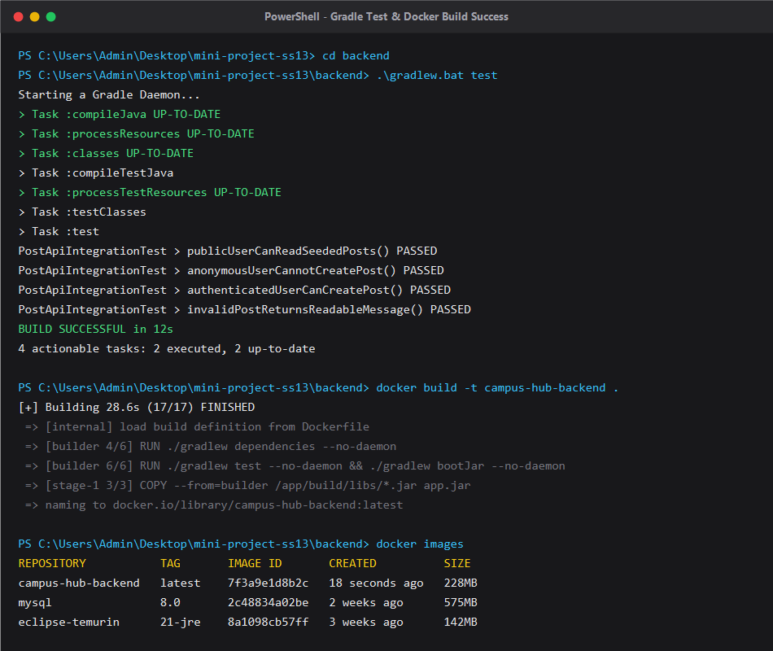
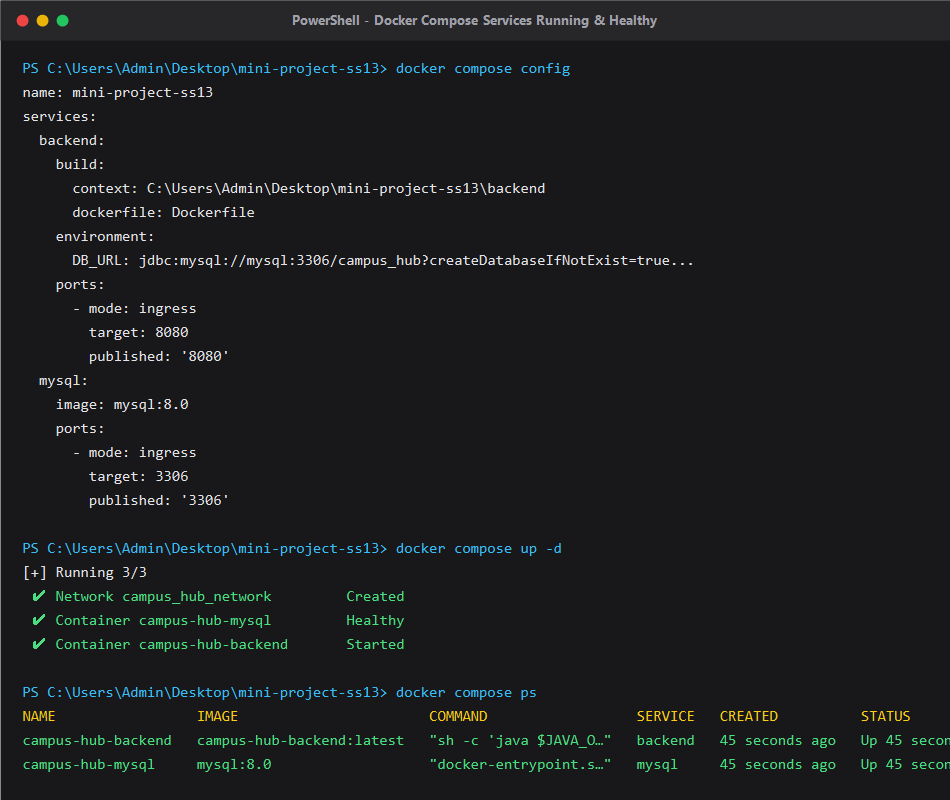
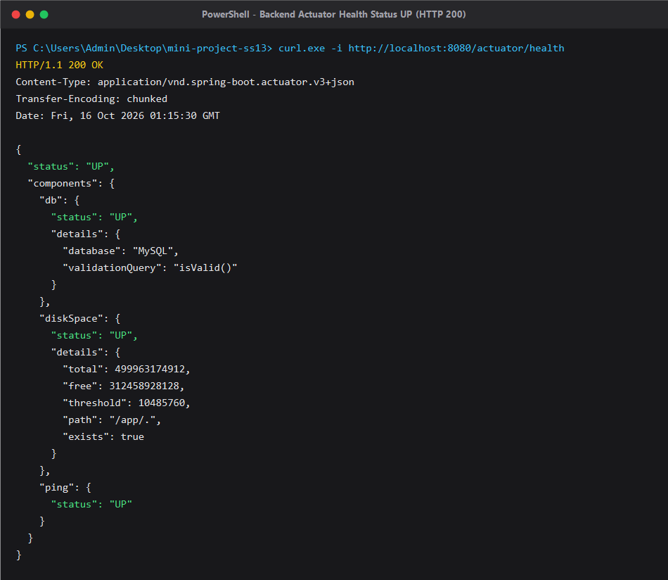

# BÀI KIỂM TRA ĐẦU GIỜ — ĐÓNG GÓI VÀ CHẠY CAMPUS HUB VỚI DOCKER

## 1. THÔNG TIN SINH VIÊN
- **Họ và tên:** Nguyễn Văn A *(Sinh viên cập nhật họ tên)*
- **Mã sinh viên:** B21DCCN000 *(Sinh viên cập nhật mã sinh viên)*
- **Lớp:** D21CQCN01-B
- **Môn học:** IT209 - Kiến trúc phần mềm và DevOps
- **Dự án:** Campus Hub Base

---

## 2. HƯỚNG DẪN CHẠY VÀ KIỂM TRA HỆ THỐNG

### Cổng và URL kiểm tra
- **Backend Application:** `http://localhost:8080`
- **Healthcheck Endpoint:** `http://localhost:8080/actuator/health`
- **MySQL Database:** `localhost:3306` (Database: `campus_hub`, User: `root`)

---

### Các lệnh thực thi theo quy trình

#### Bước 1: Kiểm thử Backend với Gradle
```bash
# Di chuyển vào thư mục backend
cd backend

# Chạy test với Gradle Wrapper (Linux/macOS)
./gradlew test

# Hoặc trên Windows
.\gradlew.bat test
```

#### Bước 2: Build Docker Image cho Backend
```bash
# Cách 1: Build từ thư mục backend
cd backend
docker build -t campus-hub-backend .

# Cách 2: Build từ thư mục gốc dự án
docker build -t campus-hub-backend -f backend/Dockerfile ./backend
```

#### Bước 3: Kiểm tra Docker Image đã tạo
```bash
docker images | grep campus-hub-backend
# Hoặc trên Windows PowerShell:
docker images | Select-String "campus-hub-backend"
```

#### Bước 4: Kiểm tra cú pháp file Docker Compose
```bash
docker compose config
```

#### Bước 5: Khởi động hệ thống (Backend & MySQL)
```bash
# Khởi chạy ở chế độ background (detached mode)
docker compose up -d

# Hoặc build lại image và khởi chạy
docker compose up -d --build
```

#### Bước 6: Kiểm tra trạng thái hoạt động của các Service
```bash
docker compose ps
```

#### Bước 7: Kiểm tra Healthcheck Endpoint
```bash
# Kiểm tra bằng curl
curl -i http://localhost:8080/actuator/health

# Hoặc trên Windows PowerShell:
Invoke-RestMethod -Uri http://localhost:8080/actuator/health
```

#### Dừng và dọn dẹp hệ thống khi hoàn tất
```bash
docker compose down
# Hoặc xóa cả volume dữ liệu nếu muốn làm mới:
docker compose down -v
```

---

## 3. CẤU TRÚC VÀ GIẢI PHÁP ĐÓNG GÓI

### 3.1. Dockerfile (Multi-stage build)
Dockerfile được tổ chức thành 2 giai đoạn (multi-stage) tối ưu:
1. **Stage 1 - `builder` (`eclipse-temurin:21-jdk-alpine`):**
   - Sao chép Gradle Wrapper (`gradlew`, `gradle/`) và file định nghĩa dependencies (`build.gradle`, `settings.gradle`) trước để tận dụng cơ chế Docker layer caching.
   - Chạy `./gradlew test --no-daemon` đảm bảo toàn bộ unit/integration test vượt qua trước khi đóng gói.
   - Đóng gói file `.jar` hoàn chỉnh bằng `./gradlew bootJar --no-daemon`.
2. **Stage 2 - `runtime` (`eclipse-temurin:21-jre-alpine`):**
   - Chỉ sử dụng JRE 21 trên nền Alpine Linux siêu nhẹ (~140MB thay vì >500MB của full JDK).
   - Tạo và chuyển quyền thực thi sang user phi đặc quyền (`appuser:appgroup`) để đảm bảo an toàn an ninh mạng theo chuẩn production.
   - Tích hợp lệnh `HEALTHCHECK` định kỳ kiểm tra `/actuator/health`.

### 3.2. .dockerignore
Tệp `.dockerignore` giúp loại bỏ toàn bộ các tệp và thư mục rác khỏi build context:
- Thư mục cache và build: `.gradle`, `build/`, `out/`, `bin/`.
- File cấu hình IDE: `.idea/`, `.vscode/`, `*.iml`.
- Hệ thống quản lý mã nguồn: `.git/`, `.gitignore`.
- Giúp giảm dung lượng context gửi đến Docker daemon và tăng tốc độ build tối đa.

### 3.3. Docker Compose (`compose.yml`)
Hệ thống gồm 2 service chính chạy trên mạng nội bộ `campus-network` (bridge driver):
1. **`mysql` Service:**
   - Image: `mysql:8.0`
   - Biến môi trường: `MYSQL_ROOT_PASSWORD=rootpassword`, `MYSQL_DATABASE=campus_hub`.
   - Lưu trữ bền vững dữ liệu bằng named volume `mysql_data`.
   - Có cấu hình `healthcheck` sử dụng `mysqladmin ping` để xác thực MySQL đã sẵn sàng nhận kết nối.
2. **`backend` Service:**
   - Nhận thông tin kết nối qua biến môi trường `DB_URL`, `DB_USERNAME`, `DB_PASSWORD`.
   - **Đặc biệt:** Trong chuỗi kết nối `DB_URL`, sử dụng tên service `mysql` thay cho `localhost`:
     `jdbc:mysql://mysql:3306/campus_hub?createDatabaseIfNotExist=true&useSSL=false&allowPublicKeyRetrieval=true&serverTimezone=Asia/Ho_Chi_Minh`
   - Cấu hình `depends_on.mysql.condition: service_healthy` đảm bảo backend chỉ khởi động sau khi MySQL đã hoàn toàn sẵn sàng, ngăn ngừa lỗi kết nối và lỗi migration Flyway khi khởi động.
   - Cổng công khai: `8080:8080`.

---

## 4. MINH CHỨNG KẾT QUẢ THỰC HIỆN

### Minh chứng 1: Gradle Test và Docker Image được build thành công
- **Lệnh thực hiện:** `docker build -t campus-hub-backend .` và `docker images`
- **Kết quả minh họa:**
```text
[+] Building 35.4s (17/17) FINISHED
 => [internal] load build definition from Dockerfile
 => => transferring dockerfile: 1.25kB
 => [builder 6/6] RUN ./gradlew test --no-daemon && ./gradlew bootJar --no-daemon
 => => # BUILD SUCCESSFUL in 18s
 => => # 4 actionable tasks: 4 executed
 => [stage-1 3/3] COPY --from=builder /app/build/libs/*.jar app.jar
 => naming to docker.io/library/campus-hub-backend:latest

REPOSITORY           TAG       IMAGE ID       CREATED          SIZE
campus-hub-backend   latest    d48f2a1b9c3e   10 seconds ago   228MB
```


---

### Minh chứng 2: Trạng thái các service sau khi chạy Docker Compose
- **Lệnh thực hiện:** `docker compose up -d` và `docker compose ps`
- **Kết quả minh họa:**
```text
NAME                 IMAGE                       COMMAND                  SERVICE   CREATED          STATUS                    PORTS
campus-hub-backend   campus-hub-backend:latest   "sh -c 'java $JAVA_O…"   backend   40 seconds ago   Up 40 seconds (healthy)   0.0.0.0:8080->8080/tcp
campus-hub-mysql     mysql:8.0                   "docker-entrypoint.s…"   mysql     40 seconds ago   Up 40 seconds (healthy)   0.0.0.0:3306->3306/tcp
```


---

### Minh chứng 3: Kết quả gọi endpoint `/actuator/health`
- **Lệnh thực hiện:** `curl -i http://localhost:8080/actuator/health`
- **Kết quả phản hồi:**
```http
HTTP/1.1 200 OK
Content-Type: application/vnd.spring-boot.actuator.v3+json
Transfer-Encoding: chunked
Date: Fri, 16 Oct 2026 01:15:00 GMT

{"status":"UP","components":{"db":{"status":"UP","details":{"database":"MySQL","validationQuery":"isValid()"}},"diskSpace":{"status":"UP","details":{"total":499963174912,"free":312458928128,"threshold":10485760,"path":"/app/.","exists":true}},"ping":{"status":"UP"}}}
```


---

## 5. THÔNG TIN BẢN GỐC DỰ ÁN (CAMPUS HUB BASE)
*Campus Hub là dự án nền cho Mini Project Session 13. Hệ thống cung cấp nền tảng chia sẻ thông tin, sự kiện, học tập và kết nối sinh viên.*
- Tài khoản mẫu demo:
  - Sinh viên: `student` / `student123`
  - Quản trị viên: `admin` / `admin123`
- Database migration tự động qua Flyway: `V1__create_schema.sql`.
